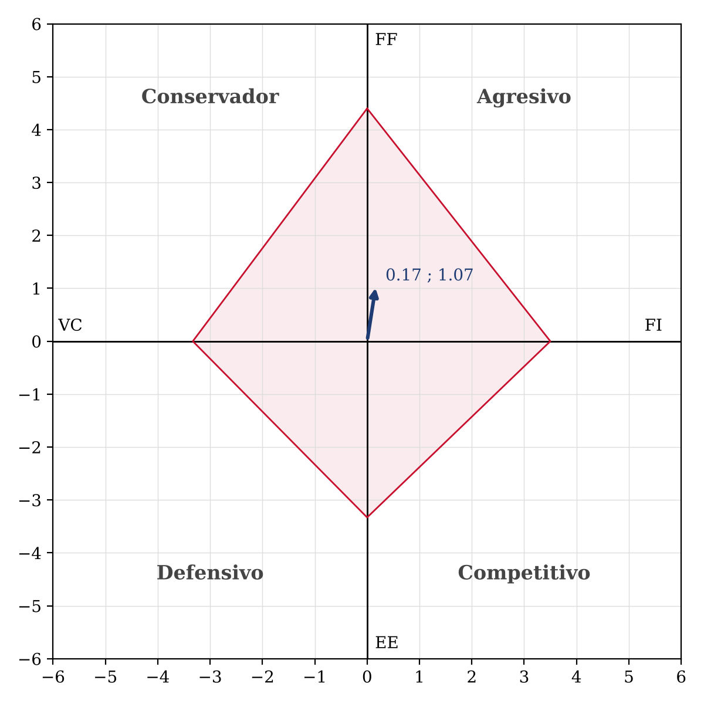
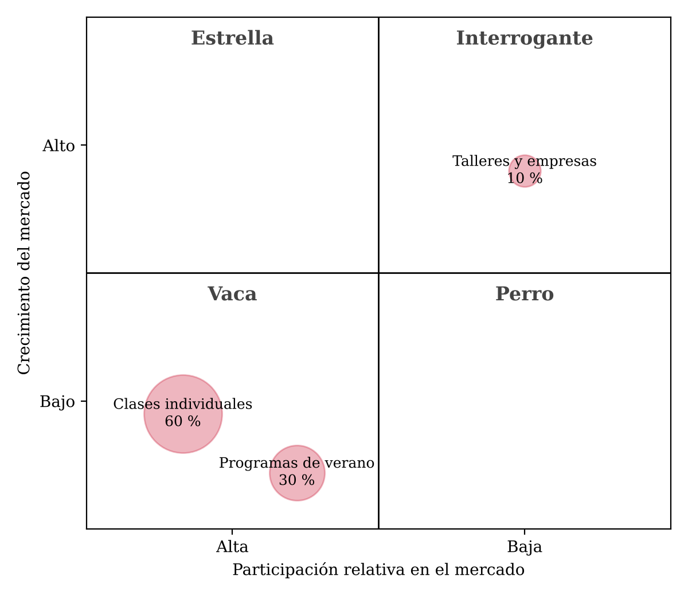

# APF2 · Parte 2 · Borrador para validar

## 3.3. Matriz de posición estratégica y evaluación de acción (MPEYEA)

La PEYEA mide la posición de la empresa con cuatro dimensiones. Dos son internas, la fuerza financiera y la ventaja competitiva. Dos son externas, la estabilidad del entorno y la fuerza de la industria (David, 2017). La fuerza financiera y la fuerza de la industria se califican de +1 a +6, donde +6 es lo mejor. La ventaja competitiva y la estabilidad del entorno se califican de −1 a −6, donde −1 es lo mejor y −6 lo peor.

Las variables salen de la MEFE, la MEFI y la MPC del primer avance. Las de fuerza financiera salen de lo que conozco de la empresa por mi trabajo. Uso cifras aproximadas, porque los montos exactos son reservados.

**Tabla 11**
*Calificación de las variables de la PEYEA*

| Dimensión | Variable | Valor | Por qué ese valor |
|---|---|---|---|
| **Fuerza financiera** | Rentabilidad | +4 | La empresa tiene utilidades, aunque los ingresos bajaron de unos S/400 000 al mes entre 2020 y 2022 a unos S/230 000 hoy. |
| | Nivel de deuda | +6 | No tiene préstamos. Solo hubo una inversión de capital al inicio. |
| | Cumplimiento de pagos | +5 | Siempre paga a tiempo a profesores y proveedores. |
| | Dinero ahorrado | +4 | Tiene un ahorro cercano a S/100 000 para invertir en cambios. |
| | Estabilidad de los ingresos | +3 | Cada mes se mueven entre S/180 000 y S/300 000, pero vienen bajando. |
| | **Promedio FF** | **+4.40** | |
| **Ventaja competitiva** | Calidad y personalización de la enseñanza | −1 | Es nuestra mayor fortaleza, F1, y en la MPC tiene 4. |
| | Seguimiento a los padres | −2 | Cada clase tiene informe y hay asesores académicos que siguen al alumno, F4. |
| | Trayectoria y marca | −3 | Más de diez años en el mercado, F2, pero la marca no es la más conocida del sector. |
| | Puntualidad y cumplimiento | −6 | Es el factor más bajo de la MPC, con 1, por las faltas y tardanzas, D2. |
| | Precio | −4 | Plataformas y tutores independientes cobran menos, MPC con 2. |
| | Captación comercial | −4 | Desorden en el área comercial y falta de inscripciones, D4 y D5. |
| | **Promedio VC** | **−3.33** | |
| **Estabilidad del entorno** | Cambios de gobierno y de normas | −4 | Pueden cambiar las reglas del sector educativo, A3. |
| | Variación de precios y de la economía familiar | −4 | Si suben los precios, las familias gastan menos en clases, A1 y O3. |
| | Fenómenos climáticos | −3 | Un corte de luz o internet afecta la clase virtual, A2. |
| | Avance de la inteligencia artificial y de sustitutos gratuitos | −5 | Cambia rápido la forma en que los alumnos resuelven dudas, A5. |
| | Normas de protección de datos | −2 | Son reglas conocidas que la empresa puede cumplir, A4. |
| | Necesidad de refuerzo escolar | −2 | El bajo logro en matemática se mantiene en el tiempo, O2. |
| | **Promedio EE** | **−3.33** | |
| **Fuerza de la industria** | Conectividad de los hogares | +6 | El 96 % de los hogares tiene internet (Forbes Perú, 2026), O1. |
| | Demanda de refuerzo en matemática | +5 | Solo el 12.8 % de los alumnos de quinto de secundaria logra el nivel esperado (Ministerio de Educación, 2026), O2. |
| | Uso de tecnología para personalizar | +4 | Las herramientas digitales ayudan a dar mejor seguimiento, O5. |
| | Facilidad de entrada de competidores | +2 | Empezar cuesta poco, según el análisis de Porter. |
| | Rivalidad y presión en precios | +2 | Hay muchas academias, tutores y plataformas. |
| | Poder de los profesores | +2 | Los buenos docentes pueden irse a otras academias, A6. |
| | **Promedio FI** | **+3.50** | |

*Nota.* Elaboración propia. Los códigos corresponden a la MEFE, la MEFI y la MPC del primer avance.

Con los promedios se calcula el vector:

**Tabla 12**
*Resultado de la PEYEA*

| Eje | Cálculo | Resultado |
|---|---|---|
| X | VC + FI = −3.33 + 3.50 | **+0.17** |
| Y | FF + EE = 4.40 − 3.33 | **+1.07** |

*Nota.* Elaboración propia.

**Figura 1**
*Vector de la PEYEA de MatLab Perú*

*Nota.* Elaboración propia.

El vector cae en el cuadrante **agresivo**, pero muy cerca del eje vertical. Quiere decir que MatLab tiene dinero para invertir y está en un sector con demanda, pero su ventaja competitiva es débil. Lo que más la debilita es la puntualidad y el cumplimiento de los profesores, que califiqué con −6.

En el cuadrante agresivo la empresa puede usar sus fortalezas para aprovechar oportunidades, superar sus debilidades y evitar amenazas. Para este cuadrante se recomiendan la penetración de mercado, el desarrollo de mercados y el desarrollo de productos, entre otras (David, 2017). Como el vector está tan cerca del eje, no conviene arriesgarse con negocios nuevos. Conviene usar el ahorro para crecer en lo que ya hace bien y, al mismo tiempo, corregir lo que la debilita.

De la PEYEA salen seis estrategias:

**Tabla 13**
*Estrategias que salen de la PEYEA*

| Cód. | Estrategia | Por qué la recomienda la PEYEA |
|---|---|---|
| E1 | Programas de nivelación por grado escolar | Es desarrollo de productos. La fuerza financiera permite diseñar y lanzar el programa sin endeudarse. |
| E2 | Campañas en redes con examen de diagnóstico gratuito | Es penetración de mercado. Aprovecha la alta conectividad, que es la variable más fuerte de la industria. |
| E3 | Campañas para familias de otras ciudades | Es desarrollo de mercados. Las clases virtuales permiten crecer fuera de Lima con poca inversión. |
| E4 | Reordenar el área comercial en el CRM | Es penetración de mercado y corrige la captación comercial, una de las variables más bajas de la ventaja competitiva. |
| E5 | Medir y premiar el cumplimiento de los profesores | La puntualidad es la peor variable de la ventaja competitiva. Mejorarla mueve el vector hacia la derecha y aleja a la empresa del cuadrante conservador. |
| E10 | Clases en grupos de tres o cuatro alumnos | Es desarrollo de productos y responde a la presión en precios de la industria. |

*Nota.* Elaboración propia.

## 3.4. Matriz Boston Consulting Group (MBCG)

La BCG ordena las líneas de negocio según dos cosas. La primera es cuánto crece su mercado. La segunda es qué parte del mercado tiene la empresa frente a su competidor más fuerte (David, 2017). Con eso cada línea cae en uno de cuatro cuadrantes: estrella, interrogante, vaca o perro.

MatLab tiene tres líneas. No hay datos públicos del tamaño de este mercado, así que la participación y el crecimiento son estimaciones mías, a partir de lo que veo en la empresa y de los resultados del primer avance.

**Tabla 14**
*Líneas de negocio de MatLab Perú en la BCG*

| Línea | Parte de los ingresos | Participación frente a la competencia | Crecimiento del mercado | Cuadrante |
|---|---|---|---|---|
| Clases individuales por paquetes de horas | 60 % | Alta. En clases individuales con asesor académico y jefe del área académica no conozco otra academia que ofrezca lo mismo. | Bajo. Hay mucha competencia y nuestras ventas vienen bajando. | **Vaca** |
| Programas de verano | 30 % | Alta. Tienen muchos alumnos y una metodología dinámica. | Bajo. Las ventas también vienen bajando. | **Vaca** |
| Talleres en grupo y programas para empresas | 10 % | Baja. La línea para empresas está en pausa por motivos externos. | Alto. Hay empresas e instituciones que buscan educación financiera y apoyo educativo, O4. | **Interrogante** |

*Nota.* Elaboración propia. Los porcentajes son aproximados y salen de mi experiencia en la empresa.

**Figura 2**
*Matriz BCG de MatLab Perú*

*Nota.* Elaboración propia. El tamaño de cada círculo muestra su parte de los ingresos.

Las dos líneas más grandes son vacas. Dan el 90 % de los ingresos y son la base de la empresa, pero ya no crecen. Una vaca hay que cuidarla, porque financia al resto. Por eso las estrategias para ellas buscan vender más en el mismo mercado y no perder calidad. La línea de talleres y empresas es un interrogante. Tiene un mercado con interés, pero hoy MatLab casi no participa. Conviene invertir en ella con cuidado, usando lo que dejan las vacas, para ver si puede convertirse en estrella.

**Tabla 15**
*Estrategias que salen de la BCG*

| Cód. | Estrategia | Línea | Por qué |
|---|---|---|---|
| E1 | Programas de nivelación por grado escolar | Clases individuales | Da una forma nueva de vender la vaca en octubre y noviembre, cuando los padres buscan que sus hijos no desaprueben. |
| E2 | Campañas en redes con examen de diagnóstico gratuito | Clases individuales | Trae más alumnos a la línea que más ingresos deja. |
| E5 | Medir y premiar el cumplimiento de los profesores | Clases individuales | La vaca depende de que el profesor cumpla. Si falla, el cliente se va y la línea pierde su ventaja. |
| E7 | Destacar el profesor fijo, el asesor académico y el reporte a padres | Clases individuales | Defiende la alta participación frente a plataformas baratas y la inteligencia artificial. |
| E10 | Clases en grupos de tres o cuatro alumnos | Programas de verano | La metodología dinámica del verano ya funciona en grupo. Llevarla a grupos chicos todo el año suma alumnos a menor precio. |
| E6 | Alianzas con colegios y empresas | Talleres y empresas | Es la forma de invertir en el interrogante con poco riesgo, porque cada alianza trae varios alumnos a la vez. |

*Nota.* Elaboración propia.
