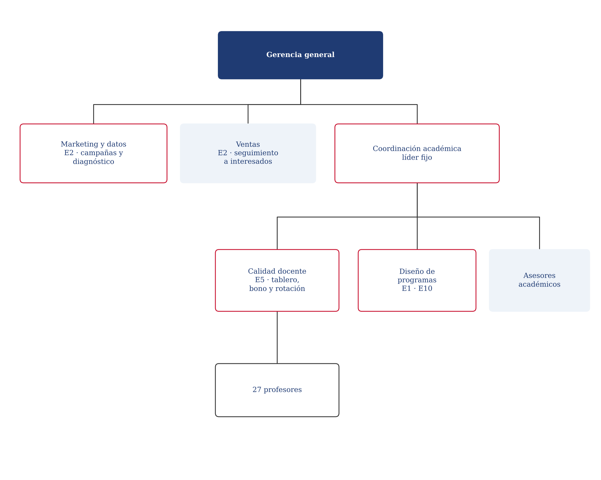

# APF3 · Parte 2 · Borrador para validar

## 4.3. El Balanced Scorecard

El Balanced Scorecard traduce la estrategia en objetivos y en indicadores que se pueden medir. Ordena los objetivos en cuatro perspectivas: financiera, clientes, procesos internos y aprendizaje y crecimiento. Los objetivos de abajo sostienen a los de arriba (David, 2017).

### Mapa estratégico

El mapa muestra cómo se conectan los objetivos. Si los profesores tienen su tablero y se quedan en la empresa, las clases mejoran. Si las clases mejoran y hay nuevos programas, llegan más alumnos. Y con más alumnos suben los ingresos.

**Figura 3**
*Mapa estratégico de MatLab Perú*

*Nota.* Elaboración propia.

### Tablero de control

El tablero pone a cada objetivo del mapa un indicador, un punto de partida, metas para 2027 y 2028, la estrategia que lo empuja y un responsable. Las metas salen de los cálculos de la Tabla 21.

**Tabla 24**
*Tablero de control de MatLab Perú*

| Perspectiva | Objetivo | Indicador | Base 2026 | Meta 2027 | Meta 2028 | Estrategia | Responsable |
|---|---|---|---|---|---|---|---|
| Financiera | FI1. Aumentar los ingresos al mes | Ingresos promedio al mes | S/230 000 | S/262 700 | S/300 000 | E1, E2, E10 | Gerencia general |
| | FI2. Ganar con nuevos programas | Parte de los ingresos que viene de nivelación y grupos | 0 % | 10 % | 20 % | E1, E10 | Coordinación académica |
| Clientes | CL1. Más alumnos en octubre y noviembre | Alumnos promedio en octubre y noviembre | 288 | 380 | 500 | E1, E2, E10 | Gerencia general |
| | CL2. Más interesados que compran | Compras por cada 100 interesados | 3 | 4 | 5.2 | E2 | Ventas |
| | CL3. Opciones por grado y en grupo | Alumnos en nivelación y en grupos en octubre y noviembre | 0 y 0 | 50 y 40 | 100 y 80 | E1, E10 | Diseño de programas |
| Procesos internos | PI1. Clases sin faltas, tardanzas ni cámara apagada | Clases con algún problema por cada 100 | 25 | 11 | 5 | E5 | Calidad docente |
| | PI2. Programas de nivelación listos | Grados con programa listo antes de octubre | 0 | 5 | 11 | E1 | Diseño de programas |
| | PI3. Campañas con diagnóstico gratuito | Interesados que hacen el diagnóstico | 0 % | 30 % | 50 % | E2 | Marketing y datos |
| Aprendizaje y crecimiento | AC1. Tablero mensual por profesor | Profesores con tablero mensual | 0 de 27 | 27 de 27 | 27 de 27 | E5 | Calidad docente |
| | AC2. Retener a los buenos profesores | Profesores que se van al año | 10 | 6 | 4 | E5 | Calidad docente |
| | AC3. Profesores formados en grupo y nivelación | Profesores capacitados para dar grupos y nivelación | 0 | 10 | 20 | E1, E10 | Coordinación académica |

*Nota.* Elaboración propia. Las metas de PI2, PI3 y AC3 son propuestas mías. Los 11 grados de PI2 son 6 de primaria y 5 de secundaria, y en 2027 se empieza por los 5 de secundaria. Los 10 profesores de AC3 alcanzan para unos 11 grupos, porque 40 alumnos / 3.5 por grupo = 11.

El tablero se revisa una vez al mes en la reunión semanal de áreas que ya existe. Así no hace falta crear reuniones nuevas.

## 4.4. Estructura organizacional

### Estructura actual

Hoy la empresa tiene una gerencia de 2 personas y tres áreas. Marketing lo dirige directamente el fundador. Ventas tiene a una persona fija al mando y 6 personas en total. El área académica la forman 5 personas que trabajan como un grupo de dirección, sin un líder fijo. Los mandos rotan según el proyecto, y ese grupo es el jefe directo de los 27 profesores.

**Figura 4**
*Estructura organizacional actual de MatLab Perú*

*Nota.* Elaboración propia con información interna.

### Pertinencia de la estructura actual para cada estrategia

**Tabla 25**
*Pertinencia de la estructura actual para las cuatro estrategias*

| Estrategia | Qué necesita | Qué hay hoy | ¿Es pertinente? |
|---|---|---|---|
| E5. Medir y premiar el cumplimiento | Una persona fija que revise cada mes el tablero de los 27 profesores, aplique el bono y responda por la meta | El área académica no tiene líder fijo y los mandos rotan. Los datos de cada clase existen, pero nadie es dueño del indicador | **No.** Sin un responsable fijo, nadie responde si las faltas no bajan |
| E10. Clases en grupos de tres o cuatro | Diseñar el formato, armar grupos por nivel y horario, y venderlo | El área académica puede diseñarlo como proyecto y ventas puede venderlo, pero nadie se encarga de armar los grupos | **En parte.** Falta quien arme y llene los grupos |
| E1. Nivelación por grado escolar | Tener los programas listos antes de octubre de cada año y mejorarlos de un año a otro | El trabajo por proyectos sirve para diseñar, pero cuando rota el mando se pierde lo aprendido del año anterior | **En parte.** Falta continuidad entre un año y otro |
| E2. Campañas con diagnóstico gratuito | Lanzar campañas, mantener el diagnóstico en la web y pasar cada interesado a ventas con sus datos | Marketing depende del tiempo del fundador. Ventas tiene quien la dirija, pero solo compran 3 de cada 100 interesados y nadie une los datos de marketing con los de ventas | **En parte.** Falta una persona que maneje las campañas y los datos |

*Nota.* Elaboración propia.

La estructura actual sirve en parte para tres estrategias y no sirve para E5, que es la más importante del plan. El problema de fondo es el mismo en todas: falta un responsable fijo para cada resultado.

### Nuevo diseño organizacional

Propongo una estructura por funciones con dueños claros, sin contratar personal nuevo. Las 13 personas de gestión se reorganizan así:

1. **Coordinación académica con líder fijo.** Una de las 5 personas del área académica pasa a coordinar el área de forma fija. Responde ante la gerencia por los resultados de los profesores y de los programas.
2. **Calidad docente.** Depende de la coordinación y es el jefe directo de los 27 profesores. Maneja el tablero mensual, el bono por cumplimiento y la rotación. Es la base de E5.
3. **Diseño de programas.** Depende de la coordinación y sigue trabajando por proyectos, pero con la misma coordinación cada año, para no perder lo aprendido. Prepara la nivelación por grado y las clases en grupo. Lleva E1 y E10.
4. **Asesores académicos.** Siguen dando seguimiento a los alumnos y a las familias, y pasan a la coordinación.
5. **Marketing y datos.** Una de las 6 personas de ventas pasa a esta función. Maneja las campañas, el examen de diagnóstico y los tableros de Looker Studio. Depende de la gerencia, que sigue dirigiendo la marca. Lleva E2.
6. **Ventas.** Mantiene a la persona que la dirige y queda con 5 personas en total. Su trabajo es seguir a cada interesado en el CRM hasta que compre o se descarte. También lleva E2.

**Figura 5**
*Estructura organizacional propuesta para MatLab Perú*

*Nota.* Elaboración propia. Las cajas con borde de color son funciones nuevas o cambiadas.

**Tabla 26**
*Indicadores de monitoreo por área de la nueva estructura*

| Área | Estrategia | Indicador de monitoreo | Base 2026 | Meta 2028 |
|---|---|---|---|---|
| Gerencia general | Todas | Alumnos promedio en octubre y noviembre | 288 | 500 |
| | | Ingresos promedio al mes | S/230 000 | S/300 000 |
| Coordinación académica | E1, E10 | Parte de los ingresos que viene de nivelación y grupos | 0 % | 20 % |
| Calidad docente | E5 | Clases con algún problema por cada 100 | 25 | 5 |
| | | Profesores que se van al año | 10 | 4 |
| Diseño de programas | E1, E10 | Grados con programa listo antes de octubre | 0 | 11 |
| | | Alumnos en grupos en octubre y noviembre | 0 | 80 |
| Marketing y datos | E2 | Interesados que hacen el diagnóstico | 0 % | 50 % |
| Ventas | E2 | Compras por cada 100 interesados | 3 | 5.2 |

*Nota.* Elaboración propia. Los indicadores son los mismos del tablero de la Tabla 24, repartidos por responsable.

Con este diseño, cada estrategia tiene un área que responde por ella y un indicador que se revisa cada mes. E5 deja de depender de mandos que rotan, E1 y E10 ganan continuidad y E2 conecta marketing con ventas.

## 4.5. Conclusiones

El plan tiene tres objetivos de largo plazo para 2028: llegar a 500 alumnos en octubre y noviembre, subir los ingresos a S/300 000 al mes y bajar las clases con problemas de 25 a 5 de cada 100. Cada uno tiene tres objetivos de corto plazo calculados con una tasa anual fija, de modo que el avance de 2027 deja a la empresa en el camino correcto.

La MEOLP mostró que las cuatro estrategias cubren los tres objetivos, y que el cumplimiento de los profesores depende solo de E5. La MEPCS mostró que E5 es la más difícil de copiar, mientras que E10 y E2 pueden recibir respuesta rápida de academias y de sustitutos gratuitos.

El Balanced Scorecard ordena once objetivos en cuatro perspectivas, con indicadores y metas para cada año. El mapa deja ver que todo empieza en los profesores: si cumplen y se quedan, mejoran las clases, llegan más alumnos y suben los ingresos.

La estructura actual no sirve para E5 y sirve solo en parte para las otras tres, porque falta un responsable fijo para cada resultado. La nueva estructura no agrega personas. Reordena a las 13 personas de gestión para que cada estrategia tenga un dueño y un indicador que se revisa cada mes.
