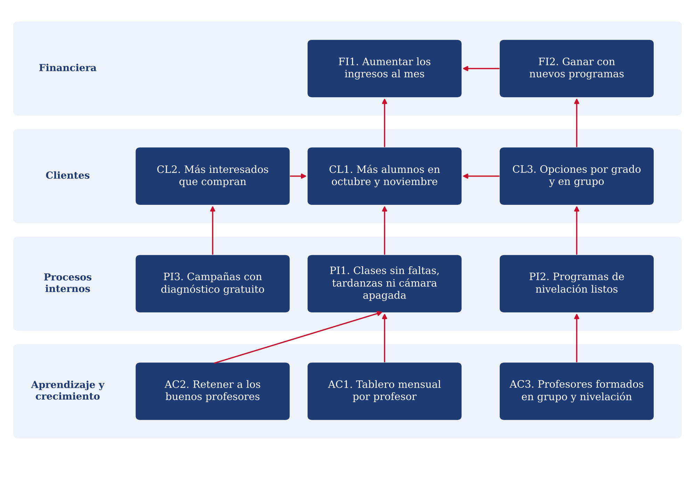
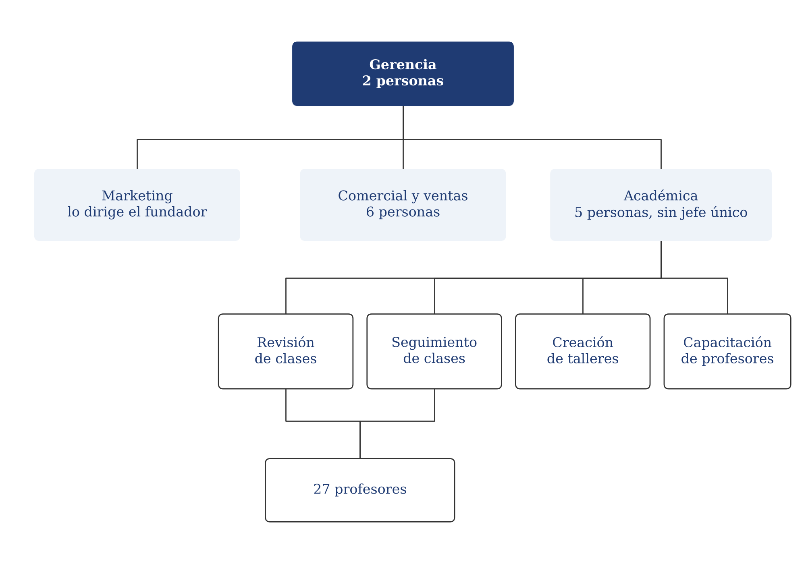

# APF3 · Parte 2 · Borrador para validar

## 4.3. El Balanced Scorecard

El Balanced Scorecard traduce la estrategia en objetivos y en indicadores que se pueden medir. Ordena los objetivos en cuatro perspectivas: financiera, clientes, procesos internos y aprendizaje y crecimiento. Los objetivos de abajo sostienen a los de arriba (David, 2017).

### Mapa estratégico

El mapa muestra cómo se conectan los objetivos. Si los profesores tienen su tablero y se quedan en la empresa, las clases mejoran. Si las clases mejoran y hay nuevos programas, llegan más alumnos. Y con más alumnos suben los ingresos.

**Figura 3**
*Mapa estratégico de MatLab Perú*

*Nota.* Elaboración propia.

### Tablero de control

El tablero pone a cada objetivo del mapa un indicador, un punto de partida, metas para 2027 y 2028, la estrategia que lo empuja y un responsable. Las metas salen de los cálculos de la Tabla 21.

**Tabla 24**
*Tablero de control de MatLab Perú*

| Perspectiva | Objetivo | Indicador | Base 2026 | Meta 2027 | Meta 2028 | Estrategia | Responsable |
|---|---|---|---|---|---|---|---|
| Financiera | FI1. Aumentar los ingresos al mes | Ingresos promedio al mes | S/230 000 | S/262 700 | S/300 000 | E1, E2, E10 | Gerencia general |
| | FI2. Ganar con nuevos programas | Parte de los ingresos que viene de nivelación y grupos | 0 % | 10 % | 20 % | E1, E10 | Coordinación académica |
| Clientes | CL1. Más alumnos en octubre y noviembre | Alumnos promedio en octubre y noviembre | 288 | 380 | 500 | E1, E2, E10 | Gerencia general |
| | CL2. Más interesados que compran | Compras por cada 100 interesados | 3 | 4 | 5.2 | E2 | Ventas |
| | CL3. Opciones por grado y en grupo | Alumnos en nivelación y en grupos en octubre y noviembre | 0 y 0 | 50 y 40 | 100 y 80 | E1, E10 | Diseño de programas |
| Procesos internos | PI1. Clases sin faltas, tardanzas ni cámara apagada | Clases con algún problema por cada 100 | 25 | 11 | 5 | E5 | Calidad docente |
| | PI2. Programas de nivelación listos | Grados con programa listo antes de octubre | 0 | 5 | 11 | E1 | Diseño de programas |
| | PI3. Campañas con diagnóstico gratuito | Interesados que hacen el diagnóstico | 0 % | 30 % | 50 % | E2 | Marketing y datos |
| Aprendizaje y crecimiento | AC1. Tablero mensual por profesor | Profesores con tablero mensual | 0 de 27 | 27 de 27 | 27 de 27 | E5 | Calidad docente |
| | AC2. Retener a los buenos profesores | Profesores que se van al año | 10 | 6 | 4 | E5 | Calidad docente |
| | AC3. Profesores formados en grupo y nivelación | Profesores capacitados para dar grupos y nivelación | 0 | 10 | 20 | E1, E10 | Capacitación de profesores |

*Nota.* Elaboración propia. Las metas de PI2, PI3 y AC3 son propuestas mías. Los 11 grados de PI2 son 6 de primaria y 5 de secundaria, y en 2027 se empieza por los 5 de secundaria. Los 10 profesores de AC3 alcanzan para unos 11 grupos, porque 40 alumnos / 3.5 por grupo = 11.

El tablero se revisa una vez al mes en la reunión semanal de áreas que ya existe. Así no hace falta crear reuniones nuevas.

## 4.4. Estructura organizacional

### Estructura actual

Hoy la empresa tiene una gerencia de 2 personas y tres áreas. Marketing lo dirige directamente el fundador. Ventas tiene a una persona fija al mando y 6 personas en total. El área académica la forman 5 personas y no tiene un jefe único. Cada una es responsable de un tema: revisión de clases, seguimiento de clases, creación de talleres, capacitación de profesores y otros. El seguimiento de clases tiene su propio jefe. En el área, yo me encargo de la creación de talleres. Entre todos son los jefes directos de los 27 profesores.

**Figura 4**
*Estructura organizacional actual de MatLab Perú*

*Nota.* Elaboración propia con información interna.

### Pertinencia de la estructura actual para cada estrategia

**Tabla 25**
*Pertinencia de la estructura actual para las cuatro estrategias*

| Estrategia | Qué necesita | Qué hay hoy | ¿Es pertinente? |
|---|---|---|---|
| E5. Medir y premiar el cumplimiento | Juntar cada mes los datos de cada profesor en un tablero, aplicar el bono y responder por la meta de clases sin problemas | Hay un responsable de revisión de clases y un jefe de seguimiento, pero trabajan por separado. Nadie junta sus datos en un solo indicador ni decide el bono, porque el área no tiene un jefe único | **En parte.** Ya existen quienes revisan, pero falta quien responda por el resultado completo |
| E10. Clases en grupos de tres o cuatro | Diseñar el formato, capacitar a los profesores, armar grupos por nivel y horario, y venderlo | Creación de talleres puede diseñar el formato y capacitación puede preparar a los profesores. Ventas puede venderlo, pero nadie se encarga de llenar los grupos | **En parte.** Falta coordinar a académica con ventas para armar los grupos |
| E1. Nivelación por grado escolar | Tener los programas listos antes de octubre de cada año y capacitar a los profesores | Creación de talleres y capacitación de profesores ya tienen responsables fijos que pueden diseñar y enseñar los programas | **Sí.** Solo hace falta un calendario para que estén listos antes de octubre |
| E2. Campañas con diagnóstico gratuito | Lanzar campañas, mantener el diagnóstico en la web y pasar cada interesado a ventas con sus datos | Marketing depende del tiempo del fundador. Ventas tiene quien la dirija, pero solo compran 3 de cada 100 interesados y nadie une los datos de marketing con los de ventas | **En parte.** Falta una persona que maneje las campañas y los datos |

*Nota.* Elaboración propia.

La estructura actual sirve para E1 y sirve en parte para las otras tres. Los responsables por tema funcionan bien para tareas concretas, como crear un taller o capacitar. El problema aparece cuando una estrategia necesita juntar el trabajo de varios responsables y alguien que responda por el resultado final, como pasa con E5 y E10.

### Nuevo diseño organizacional

Propongo mantener a los responsables por tema, que ya funcionan, y agregar quién coordina y quién responde por cada resultado. No hace falta contratar personal nuevo. Las 13 personas de gestión se reorganizan así:

1. **Coordinación académica fija.** Una de las 5 personas del área académica asume la coordinación además de su tema. Une el trabajo de los responsables, decide el bono y responde ante la gerencia por los resultados del área.
2. **Calidad docente.** Junta la revisión de clases con el tablero mensual y el bono. Es la dueña del indicador de clases sin problemas y es el jefe directo de los 27 profesores. Lleva E5.
3. **Seguimiento de clases y asesores.** Sigue igual, con su jefe, dando seguimiento a los alumnos y a las familias. Pasa sus datos a calidad docente para el tablero.
4. **Diseño de programas.** Es la actual creación de talleres, con un encargo nuevo: los programas de nivelación por grado y las clases en grupo. Lleva E1 y E10.
5. **Capacitación de profesores.** Sigue igual y prepara a los profesores para dar grupos y nivelación.
6. **Marketing y datos.** Una de las 6 personas de ventas pasa a esta función. Maneja las campañas, el examen de diagnóstico y los tableros de Looker Studio. Depende de la gerencia, que sigue dirigiendo la marca. Lleva E2.
7. **Ventas.** Mantiene a la persona que la dirige y queda con 5 personas en total. Sigue a cada interesado en el CRM hasta que compre o se descarte, y llena los grupos de E10 junto con diseño de programas. También lleva E2.

**Figura 5**
*Estructura organizacional propuesta para MatLab Perú*

*Nota.* Elaboración propia. Las cajas con borde de color son funciones nuevas o con encargos nuevos.

**Tabla 26**
*Indicadores de monitoreo por área de la nueva estructura*

| Área | Estrategia | Indicador de monitoreo | Base 2026 | Meta 2028 |
|---|---|---|---|---|
| Gerencia general | Todas | Alumnos promedio en octubre y noviembre | 288 | 500 |
| | | Ingresos promedio al mes | S/230 000 | S/300 000 |
| Coordinación académica | E1, E10 | Parte de los ingresos que viene de nivelación y grupos | 0 % | 20 % |
| Calidad docente | E5 | Clases con algún problema por cada 100 | 25 | 5 |
| | | Profesores que se van al año | 10 | 4 |
| Diseño de programas | E1, E10 | Grados con programa listo antes de octubre | 0 | 11 |
| | | Alumnos en grupos en octubre y noviembre | 0 | 80 |
| Capacitación de profesores | E1, E10 | Profesores capacitados para dar grupos y nivelación | 0 | 20 |
| Marketing y datos | E2 | Interesados que hacen el diagnóstico | 0 % | 50 % |
| Ventas | E2 | Compras por cada 100 interesados | 3 | 5.2 |

*Nota.* Elaboración propia. Los indicadores son los mismos del tablero de la Tabla 24, repartidos por responsable.

Con este diseño, cada estrategia tiene un área que responde por ella y un indicador que se revisa cada mes. E5 pasa a tener un dueño claro, E10 une a académica con ventas, E1 mantiene a sus responsables y E2 conecta marketing con ventas.

## 4.5. Conclusiones

El plan tiene tres objetivos de largo plazo para 2028: llegar a 500 alumnos en octubre y noviembre, subir los ingresos a S/300 000 al mes y bajar las clases con problemas de 25 a 5 de cada 100. Cada uno tiene tres objetivos de corto plazo calculados con una tasa anual fija, de modo que el avance de 2027 deja a la empresa en el camino correcto.

La MEOLP mostró que las cuatro estrategias cubren los tres objetivos, y que el cumplimiento de los profesores depende solo de E5. La MEPCS mostró que E5 es la más difícil de copiar, mientras que E10 y E2 pueden recibir respuesta rápida de academias y de sustitutos gratuitos.

El Balanced Scorecard ordena once objetivos en cuatro perspectivas, con indicadores y metas para cada año. El mapa deja ver que todo empieza en los profesores: si cumplen y se quedan, mejoran las clases, llegan más alumnos y suben los ingresos.

La estructura actual sirve para E1 y solo en parte para las otras tres, porque los responsables por tema no tienen a alguien que una su trabajo y responda por el resultado. La nueva estructura no agrega personas. Mantiene a los responsables por tema, suma una coordinación académica fija y una función de marketing y datos, y da a cada estrategia un dueño y un indicador que se revisa cada mes.
